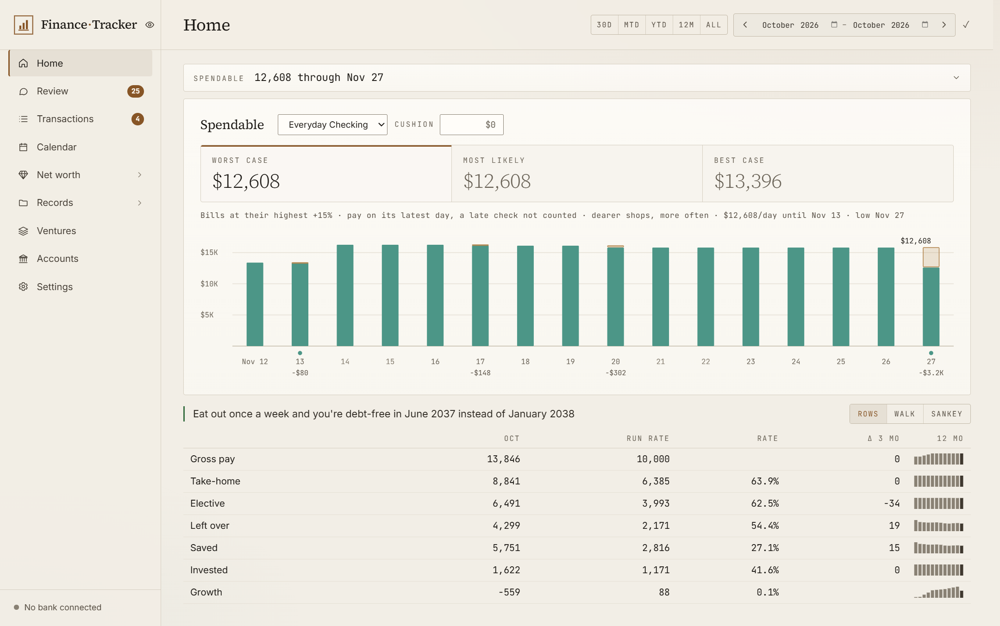
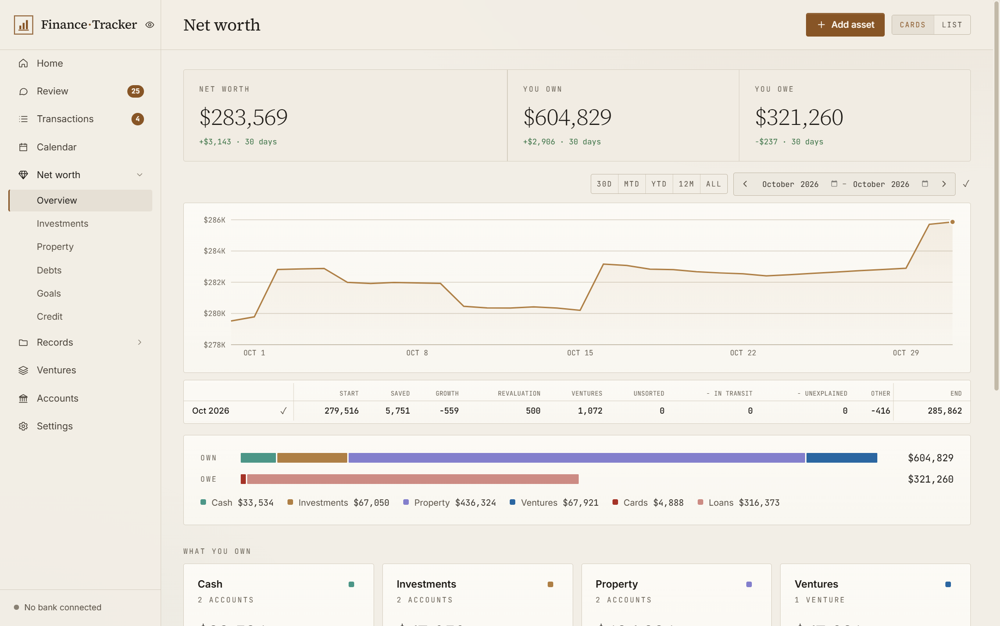
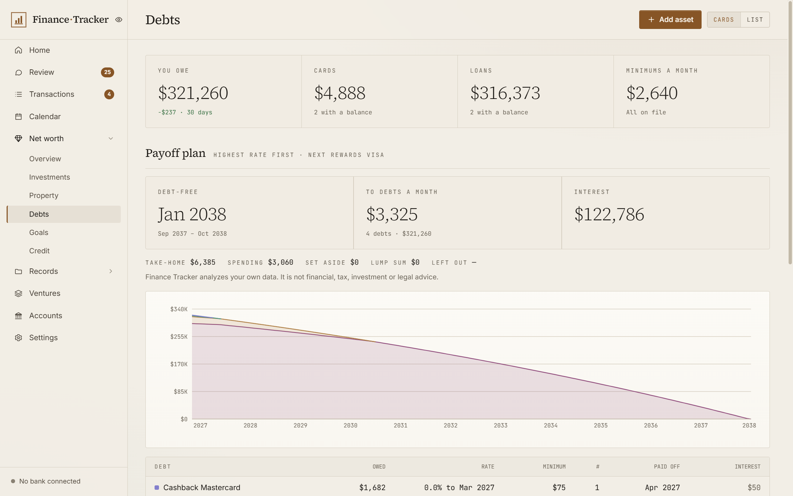

# Finance Tracker

Finance Tracker is a free, open-source personal finance app for Windows and macOS. Your
books live in one encrypted file on your computer. It reads your bank accounts
through SimpleFIN or from files you import, and walks your money from pay to
take-home to bills to spending to what you kept, with an amount and a rate at
every step. An AI can do the bookkeeping, on your own Anthropic API key or
through your own Claude Desktop; it is optional and can be turned off.

Finance Tracker is made by Lobos Labs, Inc. There is no account to create and no server
of ours: nothing goes to Lobos Labs.



## What it does

**Home.** One column from Gross pay down to Saved: Taxes, Benefits and Saved at
work come off Gross pay to give Take-home; Committed bills come off Take-home
to give Elective; Everyday spending gives Left over; One-offs give Kept; Kept
plus what was saved at work is Saved, followed by Invested and Growth. Each row
shows its amount over the span you pick, its monthly run rate, its rate (its
share of the row it came from) and how those changed over 3 months. Open a row
to see what leads into it; every figure opens the transactions behind it. Rows,
Walk and Sankey are three views of the same numbers.

**Spendable.** What you can spend from a cash account today without dropping
below your cushion before the second payday from now. Bills, paychecks and
transfers are forecast on their days; groceries and gas land on the days you
usually buy them. Three risk levels: Worst case, Most likely and Best case.
Most likely is the default. It and Best case can overestimate, which an
asterisk on the figure marks; Worst case errs low. Choose one on the card or
in **Settings → Spendable**.

**Transactions.** Categories, rules, notes and tags. Rules categorize on their
own; the AI categorizes what no rule covers, if you let it. Vendors you hide
are never named in lists or insights, though their spending still counts.

**Review.** A chat with the AI about what's unclear in your books:
uncategorized items, person-to-person payments, possible double charges,
recurring charges to confirm. It asks one question at a time and fixes things
as you answer. Deleting, hiding or closing anything waits for your Approve, and
changes can be undone.

**Monthly close.** From the 3rd of each month, once your banks have caught up,
last month's figures are frozen (on the 15th it closes anyway). If a later
change moves a closed month (a recategorized line, a late transaction, a new
rule), Review shows what moved until you accept the new figures or undo the
change.

**Net worth.** A balance sheet and its history, with a month-by-month bridge
of what moved it. Investments, Property (houses, vehicles and other assets,
with an optional monthly value lookup) and Debts, where a payoff plan shows the
order, each debt's payoff month and the interest. Goals and Credit (scores,
utilization, reports) sit beside it.





**Records.** Pay & benefits (each paycheck as its stub reads, savings plan
limits, the HSA), Insurance (policies and renewals) and Taxes (withholding,
estimated payments and whether you've met the safe harbor).

**Ventures.** A business, a rental or anything else whose money you keep apart
from your personal money, each with its own result, its assets' gains
included. A house can be part personal and part venture: rooms rented while
you live there, or a home you lived in before renting it out.

**Calendar.** Reminders, bills, paychecks and renewals on a month grid, with
the next 30 days beside it. Export it as an `.ics` file, or sync it to a Google
Calendar of its own (optional, with a Google OAuth client you create).

**Documents.** A folder for statements, paystubs, receipts and tax forms. The
AI can read what's in it when it needs to.

**Notifications and privacy.** Desktop notifications with quiet hours, a tray
icon, and a button that hides every number on screen (or starts the app with
them hidden).

## Install

Download the latest installer from [Releases](../../releases/latest).

- **Windows (64-bit):** the `.exe`. Choose **Only for me**: it needs no
  administrator, and updates then install without asking for one.
- **macOS:** the `.dmg` for your Mac: `arm64` for Apple silicon (M1 and
  later), `x64` for Intel.

Windows installers will be signed by **Lobos Labs, Inc.** Early builds may be
unsigned, and the Mac build isn't signed with an Apple Developer ID or
notarized yet, so the first launch can show a warning:

- **Windows SmartScreen**, for an unsigned build, says "Windows protected your
  PC". Choose **More info**, then **Run anyway**. Your browser may hold the
  download back first, as a file that isn't commonly downloaded: choose to
  keep it. If Smart App Control is on,
  Windows blocks unsigned apps and offers no way past it. A signed installer
  names Lobos Labs, Inc. as its publisher; any other publisher means it isn't
  ours.
- **macOS Gatekeeper** says it can't check the app for malware. Open **System
  Settings → Privacy & Security**, scroll down, and choose **Open Anyway** next
  to the app's name. If macOS says the app is damaged, run
  `xattr -dr com.apple.quarantine "/Applications/Finance Tracker.app"` in Terminal and open
  it again.

Updates come from this repository's releases. The installed app checks 30
seconds after it starts and every 6 hours while it's open; **Settings → Data →
Check for updates** checks now.

- **Windows:** an update downloads in the background and installs when you
  quit. Closing the window leaves the app running in the tray, so a
  notification says when one is ready (click it to restart into the new
  version) and the tray menu offers **Restart to update**. Nothing is
  installed while Windows shuts down or signs you out. A signed build installs
  only an update signed by Lobos Labs, Inc. An unsigned build has no publisher
  to compare with, so it checks a download against the checksum its release
  lists and nothing more.
- **macOS:** the system installs an update only for an app signed with a
  Developer ID. Until the Mac build has one, it downloads nothing. When a check
  finds a new version, a line in the window says so, the tray menu offers
  **Download version**, and **Check for updates** opens the download page. The
  app also asks macOS for a notification (after each start, and once a day
  while it stays open); macOS may not show one from an app without a Developer
  ID.

## First run

A short setup asks for the documents folder, an AI choice, a bank, and what
Home opens on. Any step can be skipped. **Load sample data** on the last step
fills every page with a made-up household, which you can remove later.

The books are encrypted from the first launch: one file, `finance.db`, with
ChaCha20-Poly1305 under a random 256-bit key. That key is kept in `finance.key`
beside it, sealed by your operating system's keystore (DPAPI on Windows, the
Keychain on macOS), so the file opens only on this computer, in your user
account, without anything to type. On a Mac, the Keychain asks for your login
password the first time, and again after each update while the Mac build has
no Developer ID (macOS ties the permission to the app's signature); choose
**Always Allow**.

The last setup step shows a **recovery code**. **Print** saves it as a PDF;
keep it somewhere other than this computer. The code is what opens your books
anywhere else: on a new computer, in another user account, or after Windows is
reinstalled. It is shown once. **Settings → Data → New recovery code**
replaces it, and **Check** tests the one you kept.

Keep a backup somewhere other than this computer too. The app backs up on its
own into the data folder (once a day, before an upgrade and before a big
change). **Settings → Data → Back up now** saves a copy wherever you pick, as
two files: the books (`.db`) and their key file (`.key`). Keep the two
together; both stay encrypted. To open them on another computer, install the
app, finish its setup, choose **Settings → Data → Restore backup**, pick the
`.db` and type the recovery code of the install that made the backup.

Every install makes its own key and its own recovery code, so setup on the
other computer shows a new code: keep that one too. A restored backup is
encrypted again under the key of the install it goes into. From then on that
install's code opens the books there and every backup made there; the old
code still opens the backups made before. A backup saved before you made a new
recovery code still needs the old code, so make a new backup after a new code,
and after a restore.

If this computer is lost and you don't have a backup and the recovery code,
nobody can open your books: not you, and not Lobos Labs. There is no reset.

Where things are:

| What | Windows | macOS |
|---|---|---|
| The books, the key file, backups, logs | `%APPDATA%\Finance Tracker\` | `~/Library/Application Support/Finance Tracker/` |
| Documents | a folder named after the app in your Documents folder (you choose it in setup) | the same |

The documents folder is an ordinary folder. If a service syncs your Documents
folder (OneDrive's folder backup on Windows, iCloud Drive's Desktop &
Documents on a Mac), it uploads that folder too. To keep those files on this
computer only, choose a folder outside the synced ones in setup or in
**Settings → Data**. The data folder with the books is outside what those two
sync.

Your API key, the SimpleFIN connection and the Google sign-in are sealed by the
operating system for this user account, so a backup restored on another
computer asks for them again.

**Settings → Data** also has **Export all data** (JSON) and **Export all
transactions** (CSV). Those files are not encrypted. **Delete all data**
removes the books, their key file, the backups, the app's log and the files
you attached in Review, and asks separately about the documents folder;
[PRIVACY.md](PRIVACY.md) lists what it leaves.

## Banks

Two ways in, and you can use both.

**SimpleFIN.** [SimpleFIN Bridge](https://beta-bridge.simplefin.org) connects
to your banks and gives the app read-only access. You open the account with
SimpleFIN and pay them directly (about $15 a year when this was written; check
their site). Create a setup token there and paste it in setup or on
**Accounts**. The app trades it once for an access URL, keeps that sealed by
the OS, and syncs whenever the bank data is more than 12 hours old while the
app is running (in the window or the tray). The first sync goes back as far as
your banks allow, within SimpleFIN's limit of about 24 requests a day. Any
server that speaks the SimpleFIN protocol works the same way.

**Files.** **Accounts → Import** reads:

- **CSV**: the app finds the header row, guesses the date, description and
  amount columns, and shows you a preview to confirm.
- **QFX and OFX** (what banks export for Quicken), versions 1 and 2.
- **QIF**: bank, cash and credit card registers, US dates.

Importing the same file twice adds nothing. Into an account SimpleFIN syncs, a
file adds only the history from before the first synced day, so nothing is
counted twice.

## AI

Optional. Choose **No AI** in setup, or turn off **AI** in **Settings → AI**.

Without an AI these still work: bank sync and imports, rules and categorizing
by hand, splits and tags, Home, Spendable, Transactions, Net worth, Goals and
the Calendar.

Some things have no entry form and are entered through the AI: paystubs and
benefit plans, insurance policies, tax returns, confirming a recurring charge,
a category's target, the debt plan's inputs, a debt's rate and minimum,
retirement figures, and accepting a closed month's new figures. The built-in
AI enters them in Review; so does Claude Desktop with **Allow changes** on.
Only the built-in AI reads the documents folder, categorizes what no rule
covers, writes Home's headline and looks up values.

### Your own Anthropic API key

Create a key in the [Claude Console](https://platform.claude.com/settings/keys)
and paste it in setup or **Settings → AI**. Anthropic bills you for what the app uses.
**Check** in setup, or **Test connection** in Settings → AI, tests the key with
the smallest call there is (one word to Claude Haiku 5.5, one token back).
**Continue** in setup runs it if you haven't, and so does saving a key in
Settings. By default Categorize runs on Claude Haiku 5.5 and
everything else on Claude Sonnet 5.5; **Settings → AI** sets the model and
effort for each feature and shows the tokens each one used.

**Cost:** it depends on your books and on how much you use Review. Categorize
runs on Claude Haiku 5.5, Anthropic's lowest-priced model, a batch of
transactions at a time. A Review message on Claude Sonnet 5.5 cost about 5
cents in our tests on the sample household, at Anthropic's list prices in
November 2026. **Settings → AI** shows the tokens each feature has used, and
the Claude Console shows what Anthropic has billed you.

What runs on its own, so you know what you're paying for:

- **Categorize**: after each sync or import, for the transactions no rule or
  earlier answer covers (turn off **Auto-categorize after sync or import** to
  run it only when you ask).
- **Headline**: the one line above Home's rows, asked for again when the
  numbers change.
- **Values**: once a month for each house and vehicle (turn off **Look up house
  and vehicle values monthly**, or turn it off for one asset).

Review and Documents run only when you use them.

### Your own Claude Desktop

If you use [Claude Desktop](https://claude.com/download) (a Pro or Max plan,
say), Claude can read your books there instead, under your Claude account. In
**Settings → Claude Desktop**:

1. Turn on **Connector**.
2. Choose **Install in Claude Desktop** and accept Claude Desktop's install
   dialog. If the dialog closes without installing, use Claude Desktop's
   **Settings → Extensions → Advanced settings → Install Unpacked Extension**
   and pick the `claude-extension` folder in the `.finance-tracker` folder in
   your home folder.
3. Ask Claude about your money.

The connector is off until you turn it on, and Claude can only read until you
turn on **Allow changes**. Every change Claude makes is listed in **Settings →
Claude Desktop** with **Undo**. The app must be open: the extension talks to
the running app over a local pipe guarded by a random token, and never opens
your books file or holds its key. The app never sees your Claude sign-in.
Turning the connector off, or quitting, closes the pipe.

The extension's relay is an ordinary MCP server over stdio
(`node ~/.finance-tracker/claude-extension/server/index.cjs`, written by
**Install in Claude Desktop**), so other MCP clients may be able to use it.
Only Claude Desktop has been tried.

### What each AI feature sends

**Settings → AI → What's sent** shows this list, and the request log under it
keeps every request as it went out, with each tool's definition kept by name
and each PDF or picture by name and size (a text file's pages are kept as
text). These go to Anthropic on your key.

- **Categorize**
  - up to 40 transactions at a time that no rule or earlier answer covers
  - each one's description, with runs of four or more digits taken out
  - its signed amount
  - the kind of account it's in (cash, credit card, loan), not the account's name
  - your category names, kinds and hints
  - up to 80 of your rules, as examples
  - your remembered facts
- **Headline**
  - today's date and how many months of history there are
  - this month's spending and income by category, and your usual pace by this day
  - the last three months' spending and income
  - this month's largest purchases, new merchants and most frequent merchants, leaving out hidden vendors
  - recurring charges, and bills due in the next 10 days
  - net worth and its 30, 90 and 365-day change
  - what's owed on each card and loan, by account name, and a payoff plan
  - the investment total and its 30-day change
  - accounts whose bank feed is behind, by name
  - trips within six weeks of today
  - how many of this month's transactions are uncategorized
  - your remembered facts
  - the last few headlines
- **Review**
  - your messages, and the names of files you attach
  - today's date, your category names, your ventures' names, kinds and residence dates, and your remembered facts
  - what its tools look up as it works: open items, transactions with their notes and tags, spending totals, recurring items, accounts with their names and balances, assets and loans, investments, taxes, benefits, insurance, credit, trips, habits, goals and calendar entries
  - the names of files in the documents folder, not their full paths
  - web searches the model runs, up to 5 per request; answering one message can take several requests
- **Values**
  - the asset's name and kind, where it is or who holds it, and its notes (an address, mileage or VIN, say)
  - when it was bought and for how much, and its last six values
  - web searches: only home-value sites for a house, only listing sites for a vehicle, and the whole web for any other asset you look up
- **Documents**
  - a file the assistant opens: a PDF as a document, a picture as an image, a text file in pages of 12,000 characters
  - its name in the documents folder
- **Key check**
  - the word "Hi" to Claude Haiku 5.5, for one output token

Web searches are run by Anthropic. Through Claude Desktop, Claude gets what
each tool it calls returns, and your Claude account's own terms and settings
apply.

## What leaves your computer

| Where | What | When |
|---|---|---|
| Anthropic, on your API key | What each AI feature sends (above), with your key and the Anthropic SDK's standard headers (its version, your OS and processor type) | Only with the AI on and a key saved |
| Claude Desktop, then Anthropic under your Claude account | What each tool Claude calls returns | Only while **Connector** is on and the app is open |
| Your SimpleFIN bridge | The setup token, claimed once; then requests for your accounts and their transactions over date ranges | When you connect, each sync, and **Sync now** |
| Google, with your own OAuth client | Each calendar item's title, date, time and amount, and a fixed note; to-do reminders to Google Tasks if you turn that on. Check-offs and new dates come back | Only if you connect Google Calendar: then when the app starts, every hour while it's open, after each bank sync, a few seconds after a calendar item changes or after the AI or Claude Desktop changes your books, and when you press **Sync now** |
| Anthropic's web search | The search terms the model writes | Review (up to 5 searches per request, and answering one message can take several requests) and Values |
| GitHub | A request for this repository's latest release, and the installer when there is a new one, with a random ID the updater makes once per install | The installed app: 30 seconds after it starts, every 6 hours, and **Check for updates** |
| Lobos Labs | Nothing | Never |

There is no telemetry, analytics or crash reporting. The app's log stays in
its data folder and records events and errors. It is written to hold nothing
from your books: a failed action is logged by its kind, not by its message.
**Copy diagnostics** puts the app's version, your system, its folders and the
log's tail on your clipboard, for you to share if you choose; read it over
first, since a folder path can carry your user name. **Report** on an AI answer
copies it to your clipboard; it goes nowhere unless you paste it somewhere.
Links you click open in your browser. [PRIVACY.md](PRIVACY.md) has the details.

## Build from source

You need [Node.js](https://nodejs.org) 26 and Git. The SQLite driver ships
prebuilt binaries, so no C compiler is needed.

```bash
git clone https://github.com/lobos-labs/finance-tracker.git
cd finance-tracker
npm ci
```

Run it from source:

```bash
npm run dev
```

A run from source keeps its own data folder (`Finance Tracker Dev`) and its own
documents folder, so it can't open, upgrade or delete the books of an
installed copy. To point it at another folder, set `FINANCE_TRACKER_DATA_DIR`:

```bash
FINANCE_TRACKER_DATA_DIR="$HOME/finance-tracker-scratch" npm run dev
```

In PowerShell:

```powershell
$env:FINANCE_TRACKER_DATA_DIR = "$HOME\finance-tracker-scratch"; npm run dev
```

A run from source keeps its database unencrypted unless you turn on **Settings
→ Data → Encrypted**. Installed builds always encrypt.

Other commands:

| Command | What it does |
|---|---|
| `npm test` | The tests, twice: on a plain database and on an encrypted one |
| `npm run typecheck` | TypeScript over the main process and the window |
| `npm run build` | Builds the app into `out/` |
| `npm run dist` | The Windows installer, in `dist/` (run it on Windows) |
| `npm run dist:open` | The release build for the computer it runs on, as the release workflow makes it, in `dist/`: the Windows installer, or on a Mac the `.dmg` and `.zip` for Apple silicon and for Intel, with the update feed's index beside them. It needs `FINANCE_TRACKER_UPDATE_URL`, and on a Mac Apple silicon with Rosetta |

A build of your own is unsigned. It checks for updates only if
`FINANCE_TRACKER_UPDATE_URL` was set when it was built: `npm run dist:open`
requires it, and `npm run dist` takes it if it is there. This edition accepts
only a GitHub releases address,
`https://github.com/<owner>/<repo>/releases/latest/download`.

## About this source

This repository is the open edition, exported as a snapshot from a private
repository where Lobos Labs also tried a hosted, paid version (plans, a license
server, phone sync, a bank connection through Plaid). The two share an engine,
so parts of the paid version are in this source:

- **The plan check still runs**, before each feature the paid version gated
  (`src/main/handlers/table.ts`, `src/main/license.ts`). In this edition it
  always answers that every feature is included, whatever is stored or set.
  The plan table it reads, prices and all, is `src/shared/plans.ts`.
- **No server of ours is called.** This source builds only the open edition
  (`electron.vite.config.ts` refuses any other), the license server's address
  is then always empty, and `test/open-edition.test.ts` holds both: the plan
  can't be lowered, and no license call is made.
- **The rest is here and out of reach:** the trial, license and plan screens
  (`src/renderer/src/Tier.tsx` and parts of Settings), phone pairing, a
  move-to-an-account uploader (`src/main/moveToAccount.ts`), and short
  stand-ins for Plaid, phone sync, the hosted AI, a developer-only Claude Code
  mode, and the hosted version's web app (`src/renderer/src/web/`: its
  Settings cards and file picker, which do nothing here). The web app's own
  pages are not in this source.

Nothing in this app is behind a plan.

Development happens in that private repository and arrives here as one commit
per export, which is why pull requests can't be merged here yet.

## Support

Support isn't promised. Issues are welcome: bugs, wrong numbers, a bank file
that won't import. Take your own names, account numbers and amounts out of
anything you post. Pull requests aren't accepted yet; see
[CONTRIBUTING.md](CONTRIBUTING.md). Report security problems privately, as
[SECURITY.md](SECURITY.md) says.

## License

Copyright © 2026 Lobos Labs, Inc. Licensed under the GNU Affero General Public
License, version 3 or any later version (AGPL-3.0-or-later): see [LICENSE](LICENSE).

Third-party code and fonts are listed with their licenses in
[THIRD_PARTY_NOTICES](THIRD_PARTY_NOTICES). The name and logo are covered by
[TRADEMARKS.md](TRADEMARKS.md).

## Disclaimers

Finance Tracker analyzes your own data. It is not financial, tax, investment or legal
advice. Check what the AI says before you rely on it.

Finance Tracker is not affiliated with, or endorsed by, Anthropic, SimpleFIN or Google.
Claude is a trademark of Anthropic, PBC.
